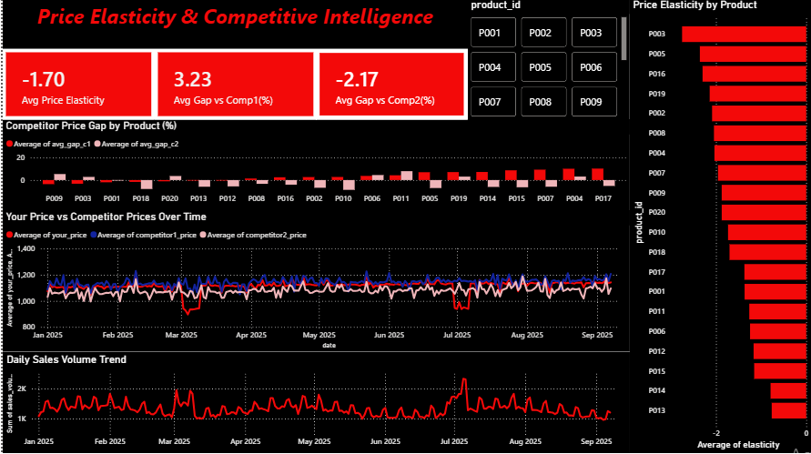

# Dynamic Price Elasticity & Competitive Intelligence Engine

## Problem
Which products can take a price change, and where does our pricing sit against two competitors?

## Data
Simulated data for 20 products over 250 days, in three tables: Products (20 rows), Prices (your price, Competitor 1 and Competitor 2) and Sales. About 2% of competitor prices and 1.5% of sales values are missing on purpose.

## Method
1. SQL (Google BigQuery): loaded the three tables, ran data quality checks (missing sales, missing Competitor 1 prices, missing Competitor 2 prices, no duplicates) and joined them on product_id and date into one table.
2. Python (Google Colab): dropped the rows with missing sales, fixed dates, and ran a log-log OLS regression per product to get price elasticity.
3. Competitor gap % = (competitor price / your price - 1) x 100. Positive means the competitor is pricier.
4. Power BI: built the dashboard from the cleaned data.

## Dashboard

## Key Insights
-> Demand is price-sensitive. The average elasticity is -1.70, and all 20 products are negative (p < 0.01). 18 of 20 are elastic (below -1), so a price cut raises revenue for them.

-> Most sensitive products: P003 (-2.75), P005 (-2.36) and P016 (-2.30). A 1% price change moves sales by about 2.3% to 2.75%.

-> Least sensitive products: P013 (-0.77) and P014 (-0.79) are inelastic, so a small price increase should raise revenue.

-> Competitor 1 is pricier than you by 3.23% on average, and the gap is largest on P017 (+10.3%), P004 (+10.1%) and P007 (+9.3%).

-> Competitor 2 is cheaper than you by 2.17% on average, most on P010 (-8.8%) and P018 (-8.0%).

-> Sales spikes line up with price dips. Your price fell in March and July 2025, and daily sales rose in both months.

## Recommendations
- P013 and P014: test a small price increase.
- P004, P007 and P017: priced well below Competitor 1, so there is room to raise prices.
- P003 and P005: most price-sensitive, so avoid increases and watch Competitor 1 on P003 and Competitor 2 on P005.
- 
## Files
- MarketDynamic (1).ipynb: cleaning and analysis
- DynamicPrice.pbix: Power BI dashboard
- DynamicPowerBI.png: dashboard screenshot

## Tools
Google BigQuery, Advanced SQL, Python (pandas, numpy, statsmodels), Google Colab, Power BI, ETL, EDA
